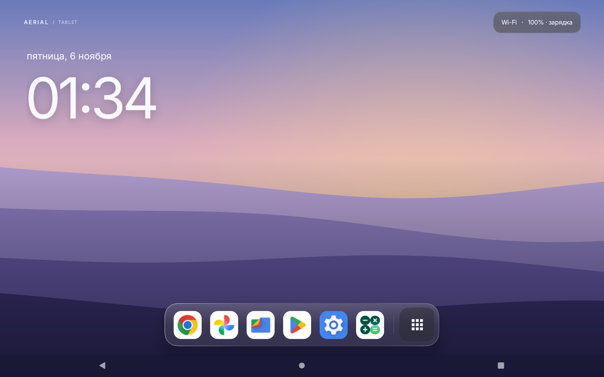
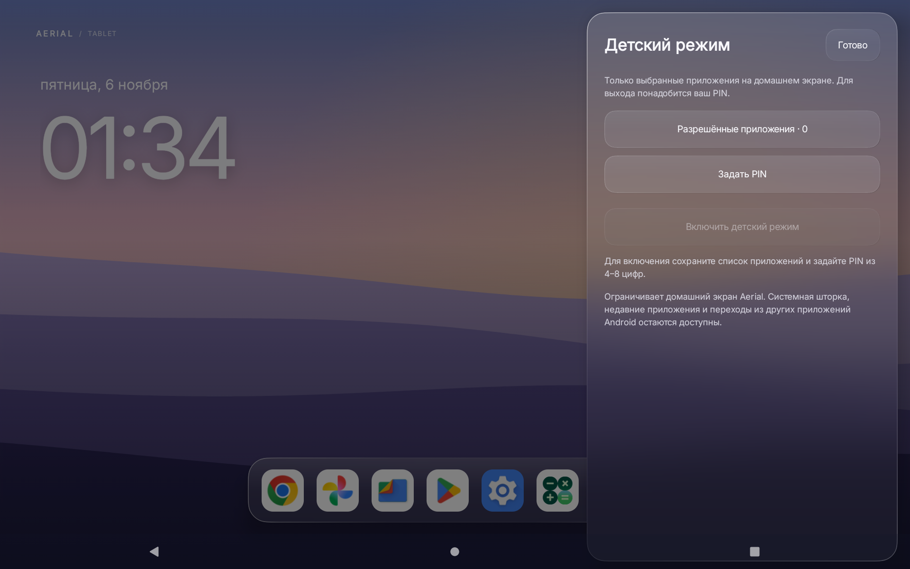

# Aerial Tablet

Нативный Android-лаунчер для планшета: спокойный домашний экран, нижний док в стиле iPadOS и матовое стекло из [Aerial UI / Aerial Gaia](https://github.com/alexkrass76/aerial-gaia).

**[Скачать актуальный APK](https://github.com/alexkrass76/aerial-tablet/releases/latest)** · [Подробная инструкция](README.txt)



## Возможности

- Крупные часы и дата, четыре встроенных фона.
- Нижний док до шести избранных приложений; изменение порядка через удержание значка.
- Библиотека приложений с поиском. Открывается кнопкой справа в доке или свайпом вверх.
- Матовое стекло для дока, меню и подложек: общая размытая текстура обоев, мягкие углы и светлая кромка.
- Пункт управления с доступом к Wi-Fi, Bluetooth, громкости, яркости и оформлению.
- Детский режим: список одобренных приложений, отдельный док и поиск, выход и настройка по PIN.
- Портретная и альбомная ориентации. Без рекламы, серверной части и сторонних runtime-библиотек.

## Установка

Требуется **Android 10 или новее**. Проверено на планшете U8 с Android 13 и экраном 1200×1920.

1. Скачайте `aerial-tablet-1.3.0.apk` из [релиза v1.3.0](https://github.com/alexkrass76/aerial-tablet/releases/tag/v1.3.0).
2. Установите APK и откройте Aerial Tablet.
3. В пункте управления откройте «Оформление» → «Сделать домашним экраном».

Установка или обновление через ADB:

```sh
adb install -r aerial-tablet-1.3.0.apk
```

Для нескольких подключённых устройств укажите нужное через `adb -s SERIAL ...`.

`install.py` — дополнительный помощник миграции: сохраняет прежний Home, назначает Aerial и снимает перехват службы KidLock, если она включена. Подробности и восстановление описаны в [инструкции](README.txt).

## Детский режим

Откройте **Пункт управления → Детский режим**, сохраните список разрешённых приложений, задайте и повторите свой PIN из 4–8 цифр, затем включите режим. Для выхода нажмите «Родителям».

В режиме скрыты остальные приложения, настройки и редактирование избранного. Список и состояние сохраняются после перезапуска. PIN хранится как PBKDF2-HMAC-SHA256 с индивидуальной солью; после неверных попыток включается пауза. Предустановленного PIN и мастер-кода нет. Восстановление забытого кода внутри приложения не предусмотрено.

**Граница режима:** ограничения действуют внутри лаунчера. Системная шторка, недавние приложения, другие пользователи Android и переходы из внешних приложений остаются доступны. Для системного ограничения устройства нужна отдельная настройка [Android lock task mode / DPC](https://developer.android.com/work/dpc/dedicated-devices/lock-task-mode).



## Сборка из исходников

Нужны **JDK 17**, Android SDK Platform **android-36**, Build Tools **36.0.0** и утилита `zip`. Сборка предназначена для macOS/Linux.

```sh
export JAVA_HOME=/path/to/jdk17
export ANDROID_HOME=/path/to/android-sdk
./build.sh
```

Результат: `build/aerial-tablet.apk`. Gradle не требуется. Другие установленные версии SDK можно выбрать переменными `SDK_PLATFORM` и `BUILD_TOOLS`.

При первой сборке создаётся локальный ключ `signing/aerial-tablet.jks`. Для последующих обновлений нужен тот же ключ. Самостоятельно созданный ключ отличается от ключа опубликованного APK, поэтому такая сборка не установится поверх релизной. Каталог `signing/` в репозиторий не включён.

Пакет приложения: `app.aerial.tablet`; актуальная версия — **1.3.0** (`versionCode=4`).

## Проверки

Для версии 1.3.0 проверены 15 сценариев детского режима на устройстве, 11 сценариев обычного лаунчера и 12 проверок PIN-кодека на JVM. Включены неверный код, смена PIN, пауза попыток, перезапуск, сохранение избранного и обе ориентации.

Запуск независимых проверок кодека:

```sh
mkdir -p build/pin-tests
javac -d build/pin-tests src/app/aerial/tablet/PinCodec.java tests/PinCodecTest.java
java -cp build/pin-tests app.aerial.tablet.PinCodecTest
```

Числа в тестах — тестовые векторы. Код тестов не входит в APK.

## Происхождение и лицензии

Это отдельный планшетный лаунчер с дизайном и частью графического кода из [alexkrass76/aerial-gaia](https://github.com/alexkrass76/aerial-gaia), форка [pengchujin/aerial-tv](https://github.com/pengchujin/aerial-tv).

- Код: [MIT](LICENSE). Атрибуция Aerial сохранена в [LICENSE-AERIAL](LICENSE-AERIAL) и исходниках адаптированных компонентов.
- Шрифт Inter: [SIL Open Font License](FONT-LICENSE-OFL.txt).
- Иконка Apps из Google Material Icons: [Apache 2.0](assets/LICENSE-MATERIAL-ICONS.txt).

Копии лицензий включены в APK.
